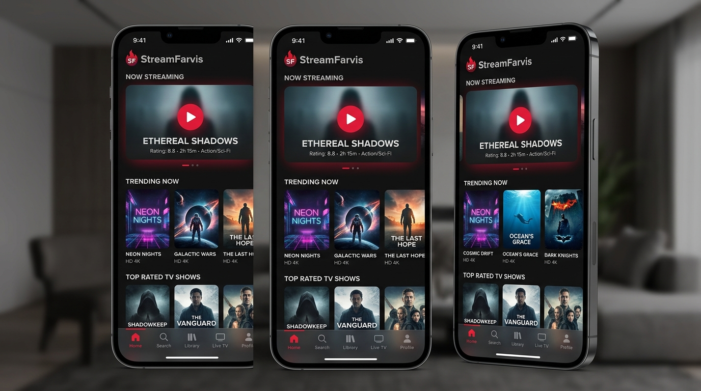
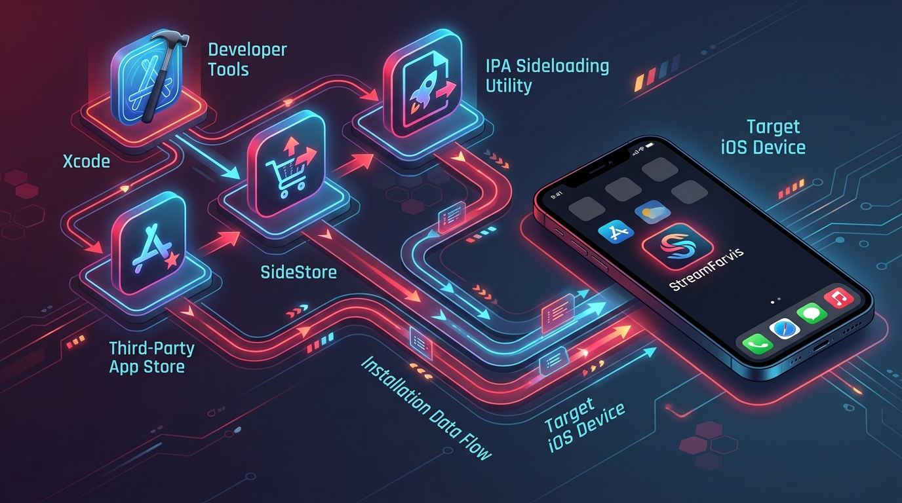

# StreamFarvis for iOS

An iOS adaptation of **StreamFarvis** (based on [Streambert](https://github.com/truelockmc/streambert) and the Android port). Built with Capacitor iOS, React 18, and native WebKit components. It features native Picture-in-Picture (PiP), safe area inset geometry for notched iPhones and Dynamic Island devices, iOS Keychain-backed encrypted token storage, and an in-app GitHub release update checker.



---

## Highlights & Features

- **Edge-to-Edge iPhone & iPad Design**: Full support for Dynamic Island, notch cutouts, and bottom home indicators with `viewport-fit=cover` and dynamic `env(safe-area-inset-*)` styling.
- **Native Picture-in-Picture (PiP)**: Stream videos in floating windows while using other apps, with inline media playback and AirPlay support.
- **iOS Keychain Token Security**: Your personal TMDB Read Access Token is encrypted securely in the Apple iOS Keychain (`SecItemAdd` / `SecItemCopyMatching`) rather than plain web storage.
- **In-App GitHub Release Checker**: Automatically checks GitHub releases for updates and provides direct IPA / release links right in Settings.
- **Touch-Optimized Motion**: Smooth momentum scrolling (`-webkit-overflow-scrolling: touch`), responsive poster rails, modal sheets, and haptic-friendly buttons.
- **Local Watchlist & History**: Offline-accessible library, watch history, and episode tracking.

---

## Sideloading & Installation Methods



Because StreamFarvis uses third-party TMDB streaming providers, it is distributed as an open-source project and `.ipa` package for sideloading. You do not need a paid Apple Developer Account—free Apple IDs work with modern sideloading tools.

### Option 1: Sideloadly (Windows & macOS — Recommended)
1. Download and install [Sideloadly](https://sideloadly.io/) on your PC or Mac.
2. Connect your iPhone or iPad to your computer via USB (select "Trust This Computer" if prompted).
3. Download the latest `StreamFarvis.ipa` from the [GitHub Releases](https://github.com/FloKuersten/StreamFarvis/releases).
4. Drag and drop the `.ipa` file into Sideloadly.
5. Enter your Apple ID email and click **Start**.
6. Once installation completes, on your iPhone go to **Settings → General → VPN & Device Management** and trust your Developer App certificate.
7. Launch **StreamFarvis** and enjoy!

### Option 2: AltStore / SideStore (Wireless On-Device Refresh)
1. Install [AltStore](https://altstore.io/) or [SideStore](https://sidestore.io/) on your iOS device.
2. Download `StreamFarvis.ipa` in Safari on your iPhone.
3. Open the downloaded file in AltStore/SideStore.
4. The app will be signed and installed on your device, with background wireless refreshing.

### Option 3: TrollStore (Permanent Sign — iOS 14.0–17.0)
If your device is running an iOS version supported by [TrollStore](https://github.com/opa334/TrollStore):
1. Download `StreamFarvis.ipa`.
2. Open with TrollStore to install permanently without 7-day expiration or app ID limits.

---

## Building from Source (macOS + Xcode)

### Prerequisites
- **Node.js**: v22.12 or newer
- **macOS**: macOS Sonoma or Sequoia with **Xcode 15 or 16**
- **CocoaPods** or Swift Package Manager (Capacitor 8 uses modern SPM)

### Step-by-Step Build Commands

1. **Clone the repository and install dependencies**:
   ```bash
   git clone https://github.com/FloKuersten/StreamFarvis.git
   cd StreamFarvis
   npm ci
   ```

2. **Build the web application for iOS**:
   ```bash
   npm run build:ios
   ```

3. **Synchronize native iOS assets**:
   ```bash
   npm run ios:sync
   ```

4. **Open in Xcode**:
   ```bash
   npm run ios:open
   ```
   *(Or double-click `ios/App/App.xcodeproj`)*

5. **Configure Signing in Xcode**:
   - In Xcode's project navigator, select the **App** project root.
   - Go to **Signing & Capabilities**.
   - Check **Automatically manage signing** and select your personal Apple ID team.
   - Set a unique Bundle Identifier if needed (e.g., `com.yourname.streamfarvis`).

6. **Run on Device or Simulator**:
   - Select your connected iPhone or a simulator target (e.g. *iPhone 16 Pro*).
   - Press **Cmd + R** (Product → Run).

7. **Exporting an IPA**:
   - In Xcode, select **Product → Archive**.
   - In the Organizer window, click **Distribute App → Custom → Ad Hoc / Development**.
   - Export `StreamFarvis.ipa` to your desktop.

---

## Architecture & Code Structure

| Component | Path | Description |
|---|---|---|
| **Capacitor Configuration** | `capacitor.config.json` | iOS schemes (`streamfarvis`), content insets, dark theme background |
| **Native Plugin** | `ios/App/App/StreamFarvisPlugin.swift` | Swift bridge implementing Keychain storage, URL launching, and player presentation |
| **Native Player Controller** | `ios/App/App/PlayerViewController.swift` | Fullscreen `WKWebView` with native Picture-in-Picture, progress indicator, and ad/popup filtering |
| **Platform Bridge** | `src/platform/androidBridge.js` | Unified web-to-native compatibility shim for iOS & Android |
| **iOS Styles** | `src/styles/android.css` | Safe-area padding, touch momentum, Dynamic Island offsets, and custom glassmorphism navigation |
| **Update Checker** | `src/utils/updates.js` | Semantic versioning comparison and asset mapping for `.ipa` and `.apk` releases |

---

## License

StreamFarvis is released under the **GNU General Public License v3** ([LICENSE](LICENSE)). Based on [Streambert](https://github.com/truelockmc/streambert). Movie and TV metadata is powered by TMDB.
