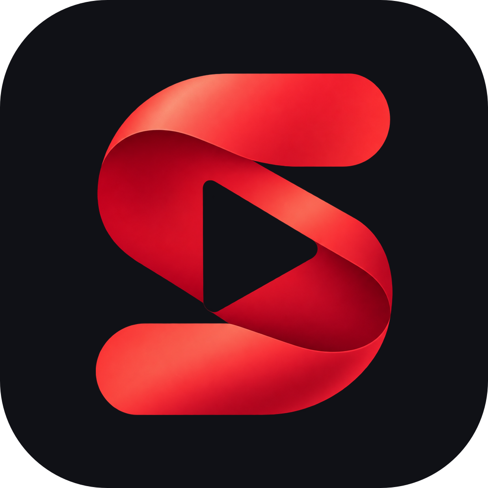
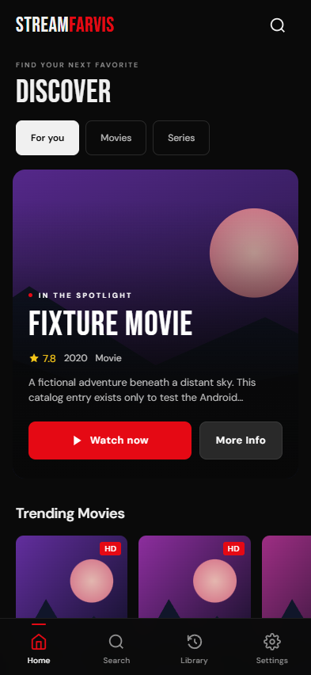
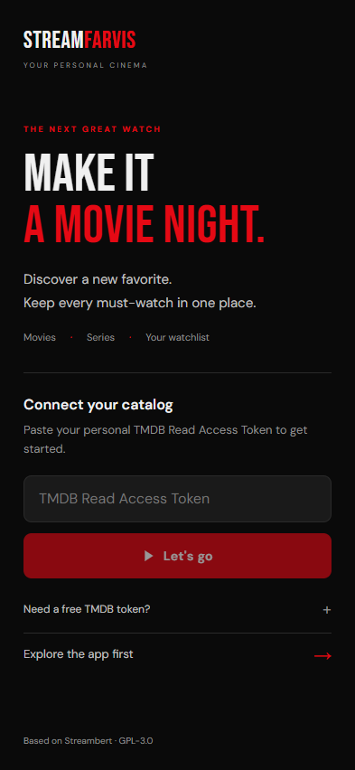
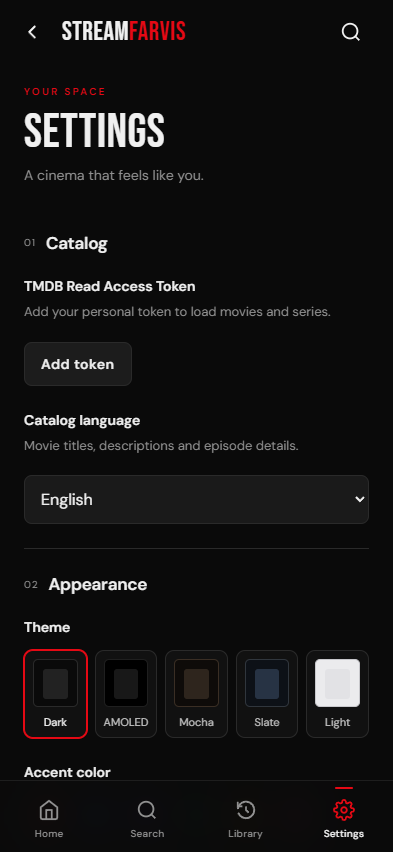
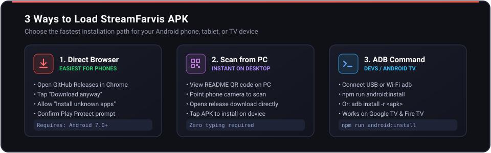
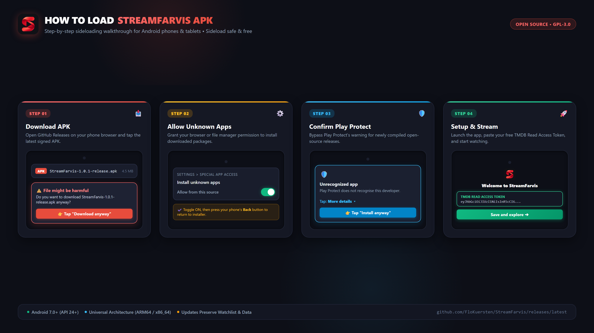
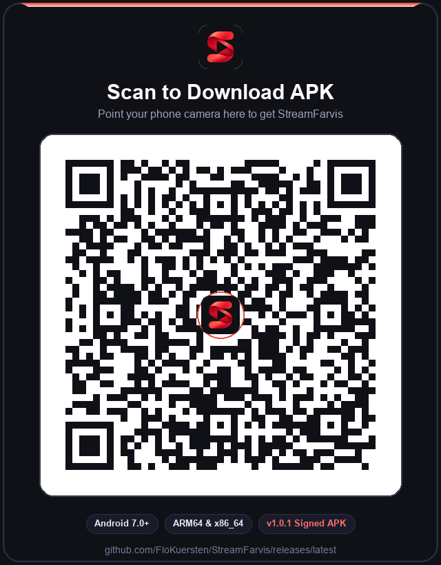

<p align="center">
  
</p>

<h1 align="center">StreamFarvis</h1>

<p align="center">
  <b>Cinematic Android streaming client featuring TMDB discovery, watchlist tracking, and isolated player window.</b>
</p>

<p align="center">
  <a href="https://github.com/FloKuersten/StreamFarvis/releases/latest"></a>
  <a href="docs/INSTALL.md"></a>
  <a href="IOS.md"></a>
  
  <a href="LICENSE"></a>
</p>

<p align="center">
  <a href="https://github.com/FloKuersten/StreamFarvis/releases/latest"><b>📥 Download Latest Release</b></a> ·
  <a href="docs/INSTALL.md"><b>🤖 Android Guide</b></a> ·
  <a href="IOS.md"><b>🍎 iOS App Guide</b></a> ·
  <a href="docs/DEVELOPMENT.md"><b>🛠️ Build from Source</b></a> ·
  <a href="https://github.com/FloKuersten/StreamFarvis/issues/new/choose"><b>🐛 Report Issue</b></a>
</p>

<p align="center">
  
  
  
</p>

<p align="center">
  <i>Phone previews with synthetic fixture data. For full details on verification, see <a href="docs/VALIDATION.md">validation record</a>.</i>
</p>

---

## How to Load the APK

StreamFarvis is distributed directly as an installable, standalone Android APK for phone, tablet, and TV devices.

<p align="center">
  
</p>

### Quick Sideload (Phone / Tablet)

<p align="center">
  
</p>

1. **Download:** Open the [Latest GitHub Release](https://github.com/FloKuersten/StreamFarvis/releases/latest) on your device and tap `StreamFarvis-1.0.1-release.apk` (or use the [Direct Download Link](https://github.com/FloKuersten/StreamFarvis/releases/download/android-v1.0.1/StreamFarvis-1.0.1-release.apk)).
   - If prompted *"File might be harmful"*, tap **Download anyway**.
2. **Allow Installation:** Tap the downloaded file. When prompted *"Install unknown apps"*, tap **Settings** &rarr; toggle **Allow from this source** &rarr; tap **Back**.
3. **Play Protect:** If Google Play Protect displays *"Unrecognized app"*, tap **More details** &rarr; **Install anyway**.
4. **Setup Token:** Launch StreamFarvis, tap **Setup instructions**, and enter your personal **TMDB Read Access Token** ([step-by-step token guide](tmdb-tutorial.md)).

> [!TIP]
> **Reading this on your PC?** Scan the QR code below with your phone camera to jump straight to the download:
>
> <p align="center">
>   <a href="https://github.com/FloKuersten/StreamFarvis/releases/latest"></a>
> </p>
>
> **Using Android TV or Amazon Fire TV Stick?** Open the **Downloader** app and enter the shortlink `tinyurl.com/24lduo78` to download the APK directly with your TV remote.

### Fast ADB Sideload (PC / Android TV / Emulators)

If your device is connected via USB or Wi-Fi with USB Debugging enabled:

```bash
# Automated install using repository helper script:
npm run android:install -- --release --launch

# Automatically download & install the official release if missing locally:
npm run android:install -- --release --download

# Or directly with adb (-r preserves data, -d allows downgrade, -t allows test packages):
adb install -r -d -t artifacts/StreamFarvis-1.0.1-release.apk
```

### Checksum Verification

Verify the downloaded release APK using SHA-256 before installation:

```text
SHA-256: 793f0bfa90da6027d0e78e1ed04491eb50966b930807a447ad7cd92c0b56d565  StreamFarvis-1.0.1-release.apk
```

- **PowerShell:** `Get-FileHash .\StreamFarvis-1.0.1-release.apk -Algorithm SHA256`
- **Linux/macOS:** `sha256sum StreamFarvis-1.0.1-release.apk`

> [!IMPORTANT]
> **Preserving Your Data on Updates:**
> Never uninstall StreamFarvis before upgrading! Simply install the new `.apk` over the existing app. All official GitHub releases are signed with the same release identity, preserving your watchlist, history, and encrypted Keystore tokens.

👉 **Looking for TV instructions or troubleshooting? Read the [Complete Installation Guide (docs/INSTALL.md)](docs/INSTALL.md).**

---

## Features

- **Cross-Platform Mobile**: Complete support for Android (phone, tablet, Android TV) and iOS (iPhone & iPad).
- **Native Picture-in-Picture (PiP)**: Watch videos in floating windows on Android and iOS while multitasking.
- **Android TV Leanback**: Dedicated TV launcher banner and 2D D-pad remote navigation with high-contrast glowing focus indicators.
- **Dynamic Island & Safe Area**: Pixel-perfect notch offsets and edge-to-edge layout via `viewport-fit=cover`.
- **In-App GitHub Release Checker**: Automatic updates check against GitHub releases with 1-tap download in settings.
- **Hardware-Backed Credential Security**: TMDB Read Access Tokens encrypted in Android Keystore and Apple iOS Keychain.
- **Catalog & Library**: TMDB movie/TV discovery, multi-provider playback, offline watchlist, and history.

## Current limits

Desktop local-file downloads, desktop file converter, AllManga resolver, and Discord RPC are not part of the mobile builds. Anime uses standard TMDB providers and season numbering. Sideloading via APK (Android) or IPA / AltStore / Sideloadly (iOS) is required.

Providers operate independently of StreamFarvis. Availability, video compatibility, subtitles, ads, and tracking can vary. Popup blocking does not reproduce Streambert's full desktop request-blocking engine. End-to-end playback across providers and physical Android devices has not been verified. Only access content you are entitled to watch.

## Development and support

See [development instructions](docs/DEVELOPMENT.md) for local builds, [Android notes](ANDROID.md) for implementation details, and the [design direction](docs/DESIGN.md) for the mobile UI reference and decisions. [Contributing](CONTRIBUTING.md) explains what to include in bug reports and pull requests. Report vulnerabilities privately using the [security policy](SECURITY.md).

The interface has been checked at phone, landscape, and tablet sizes. The [validation record](docs/VALIDATION.md) distinguishes browser fixtures, native emulator checks, and unverified playback scenarios. Release notes describe the checks performed for each APK and any remaining limitations.

## Credits and license

StreamFarvis is based on **Streambert 2.6.0** by **truelockmc and contributors**, starting from [commit `4afe564`](https://github.com/truelockmc/streambert/commit/4afe564e5ea2565c96d6f2e61679c00fad2d498c). It retains the upstream React interface, catalog, library, theme system, artwork, and provider URL generation. The original project documentation is preserved in [docs/UPSTREAM.md](docs/UPSTREAM.md).

Distributed under **GNU GPL v3**. See [LICENSE](LICENSE). Source code is available in this repository and in the corresponding release source archive.

This product uses the TMDB API but is not endorsed or certified by TMDB.
